# NeuralFX TradingBot — Design Document

> **Scope:** This document is the single source of truth for the bot's architectural hierarchy, UI/UX standards, response templates, and user workflows. Every new agent, strategy, technique, or dashboard component **must** conform to the rules defined here.

---

## Table of Contents

1. [System Architecture](#1-system-architecture)
2. [Tier Definitions & Responsibilities](#2-tier-definitions--responsibilities)
3. [Current System Inventory](#3-current-system-inventory)
4. [Signal Lifecycle](#4-signal-lifecycle)
5. [UI/UX Standards](#5-uiux-standards)
6. [Response Templates](#6-response-templates)
7. [Workflow & Subflow Reference](#7-workflow--subflow-reference)
8. [Dashboard Design Standards](#8-dashboard-design-standards)
9. [Error Handling Standards](#9-error-handling-standards)
10. [Extension Guide](#10-extension-guide)

---

## 1. System Architecture

The bot uses a strict **5-tier hierarchy**. Every trading decision flows top-down through this stack. No tier may skip a level — a Rule cannot be invoked without its Technique, and a Technique cannot run without its Strategy.

```mermaid
graph TD
    TB["🤖 Trading Bot<br/><small>Orchestrator · main.py</small>"]

    TB --> A1["📡 Market Agent"]
    TB --> A2["🧠 Strategy Agent"]
    TB --> A3["⚖️ Risk Agent"]
    TB --> A4["⚡ Execution Agent"]
    TB --> A5["🛡️ Council Agent"]
    TB --> A6["📚 Learning Agent"]
    TB --> A7["🌍 Crucix Agent"]

    A2 --> S1["DeepSeek Strategy<br/><small>Primary LLM Signal Generator</small>"]
    A2 --> S2["ICT/SMC Strategy<br/><small>Smart Money Concepts</small>"]
    A2 --> S3["SMA Crossover Strategy<br/><small>Trend Following Fallback</small>"]

    S1 --> T1["Prompt Engineering<br/><small>20-bar H1 context builder</small>"]
    S1 --> T2["Response Validation<br/><small>JSON sanity checks</small>"]
    S1 --> T3["Cache Management<br/><small>30-min TTL per symbol</small>"]

    S2 --> T4["Market Structure<br/><small>BOS · CHoCH · Swing Points</small>"]
    S2 --> T5["Smart Money Tools<br/><small>FVG · Order Blocks · Liquidity</small>"]
    S2 --> T6["Session & Bias<br/><small>HTF bias · Session killzones</small>"]
    S2 --> T7["Setup Scoring<br/><small>6 setup models · Confluence</small>"]

    S3 --> T8["MA Crossover<br/><small>Fast/Slow SMA signal</small>"]

    T1 --> R1["IF candles ≥ 20 AND API_KEY set → call API"]
    T1 --> R2["Include Crucix macro context IF available"]

    T2 --> R3["IF confidence < 65% → HOLD"]
    T2 --> R4["IF BUY AND SL ≥ entry → reject"]
    T2 --> R5["IF SELL AND SL ≤ entry → reject"]

    T4 --> R6["IF BOS confirmed on HTF AND LTF → bias set"]
    T4 --> R7["IF CHoCH detected → structure shift flagged"]

    T5 --> R8["IF price enters FVG AND OB confluence → entry zone valid"]
    T5 --> R9["IF liquidity sweep confirmed → reversal setup eligible"]

    T6 --> R10["IF session = London/NY AND killzone active → weight +1"]
    T6 --> R11["IF HTF bias = bullish AND setup = LONG → bias aligned"]

    T7 --> R12["IF score ≥ 60 AND confidence ≥ threshold → signal emitted"]

    T8 --> R13["IF SMA_fast crosses above SMA_slow → BUY signal"]
    T8 --> R14["IF SMA_fast crosses below SMA_slow → SELL signal"]

    A5 --> C1["ICT Expert<br/><small>FVG · OB · Liquidity · Killzones</small>"]
    A5 --> C2["DanialFX Expert<br/><small>Fib Golden Zone · S/D · BBMA</small>"]
    A5 --> C3["Traditional Expert<br/><small>RSI · SMA · HH/HL · Volume</small>"]

    C1 --> R15["IF majority score ≥ 80% → signal approved"]
    C2 --> R15
    C3 --> R15

    A3 --> V1["Drawdown Circuit Breaker"]
    A3 --> V2["Duplicate Signal Guard"]
    A3 --> V3["Correlation Guard"]
    A3 --> V4["Live Spread Check"]
    A3 --> V5["Position Sizing"]

    style TB fill:#0e0e10,color:#00ff88,stroke:#00ff88
    style A2 fill:#0e0e10,color:#d500f9,stroke:#d500f9
    style A3 fill:#0e0e10,color:#ff4455,stroke:#ff4455
    style A4 fill:#0e0e10,color:#f0f0f0,stroke:#f0f0f0
    style A5 fill:#0e0e10,color:#ff9d00,stroke:#ff9d00
    style S1 fill:#0e0e10,color:#d500f9,stroke:#d500f9
    style S2 fill:#0e0e10,color:#4da6ff,stroke:#4da6ff
    style S3 fill:#0e0e10,color:#607888,stroke:#607888
```



---

## 2. Tier Definitions & Responsibilities

### Tier 1 — Bot (Orchestrator)

The **Bot** is the top-level process (`main.py`). It owns the main loop, coordinates all agents in sequence, and is the sole entity that reads from or writes to the broker connection. It does not contain business logic — it routes.

**Responsibilities:**
- Maintain the heartbeat loop (configurable interval, default 30s)
- Sequence agent calls in the canonical pipeline order
- Aggregate signals from all strategies, rank by confidence
- Pass the top-ranked signal through Council → Risk → Execution
- Handle loop-level errors without crashing (log and continue)
- Enforce daily snapshot scheduling (Learning Agent callbacks)

**What it does NOT do:** Analyze market data, generate signals, manage trades, or make risk decisions.

---

### Tier 2 — Agent

An **Agent** is a specialized, stateful service responsible for one domain question. Each agent has a single verb answer (e.g., *"Is it safe?"*, *"What is the market doing?"*). Agents communicate only through the Bot — never directly with each other.

| Agent | Domain Question | Key Output |
|---|---|---|
| `CrucixAgent` | What is the macro environment? | `MacroContext` (tier, VIX, sentiment, lot_scale) |
| `MarketAgent` | What is the market doing? | `MarketData`, validated candles |
| `AnalysisAgent` | What does it mean? | `MarketContext` (RSI, ATR, SMA, regime, session) |
| `StrategyAgent` | Is there a trade? | `list[Signal]` sorted by confidence |
| `CouncilAgent` | Do the experts agree? | `CouncilVerdict` (approved bool + confidence) |
| `RiskAgent` | Is it safe? | `bool` + position size |
| `ExecutionAgent` | Can we execute it? | `Trade` (filled order record) |
| `TradeManagerAgent` | What do we do with the trade? | SL moves, partial closes, reconciliation |
| `LearningAgent` | What did we learn? | Updated strategy confidence scores |
| `LoggingAgent` | (Records everything) | DB rows, Telegram alerts |

---

### Tier 3 — Strategy

A **Strategy** is a broad trading philosophy operated by the Strategy Agent. Each strategy implements the `BaseStrategy` abstract interface and answers: *given this market context, is there a trade?*

A strategy is responsible for:
- Deciding whether market conditions meet its entry criteria
- Computing a stop loss and three take profit levels
- Returning a `Signal` with a confidence score, or `None`

Strategies do **not** manage risk, sizing, or execution — that belongs to agents further down the pipeline.

| Strategy | Class | Philosophy | Primary Signal Source |
|---|---|---|---|
| DeepSeek | `DeepSeekStrategy` | LLM reasoning over price action | DeepSeek chat API (`deepseek-chat`) |
| ICT/SMC | `ICTStrategy` | Smart money concepts — liquidity, order flow | `ICTEngine` (10 sub-modules) |
| SMA Crossover | `SMACrossoverStrategy` | Trend following via moving average crossover | Fast/slow SMA state |

---

### Tier 4 — Technique

A **Technique** is a specific analytical method applied within a strategy. A strategy may combine multiple techniques; each technique produces a boolean or scored intermediate result that feeds the strategy's signal decision.

**DeepSeek Techniques:**

| Technique | Module | Function |
|---|---|---|
| Prompt Engineering | `deepseek_strategy._build_prompt` | Formats 20-bar OHLCV + indicators into LLM prompt |
| Response Validation | `deepseek_strategy._parse` | Validates JSON direction, confidence, SL/TP sanity |
| Cache Management | `deepseek_strategy.detect` | Per-symbol 30-min TTL prevents API hammering |

**ICT/SMC Techniques:**

| Technique | Module | Function |
|---|---|---|
| Market Structure | `strategies/ict/structure.py` | Detects BOS, CHoCH, swing highs/lows, dealing range |
| Liquidity Mapping | `strategies/ict/liquidity.py` | Maps BSL/SSL levels, detects liquidity sweeps |
| Displacement Detection | `strategies/ict/displacement.py` | Identifies impulsive moves following sweeps |
| Fair Value Gap | `strategies/ict/fvg.py` | Detects, tracks, and validates FVG entry zones |
| Order Block Detection | `strategies/ict/orderblock.py` | Detects, scores, and validates OB entry zones |
| Session & Killzones | `strategies/ict/session.py` | Resolves London/NY/Asian session state |
| HTF Bias Resolution | `strategies/ict/bias.py` | Determines premium/discount, HTF trend direction |
| Fibonacci Confluence | `strategies/ict/fibonacci.py` | Golden zone validation, retracement depth check |
| Setup Scoring | `strategies/ict/scoring.py` | Weights all technique outputs into a confidence score |
| Setup Detection | `strategies/ict/setups.py` | Runs 6 named setup models against full ICT context |

**SMA Crossover Techniques:**

| Technique | Function |
|---|---|
| MA Crossover | Detects when fast SMA crosses slow SMA |

---

### Tier 5 — Rule

A **Rule** is an atomic, boolean condition. It has no sub-parts. Rules are the execution leaves of the hierarchy — they evaluate to true or false and directly gate signal emission or rejection.

Rules must be expressed in the form:
**`IF <measurable condition> [AND <condition>] → <action>`**

**Examples:**

```
# DeepSeek — Validation Rules
IF confidence < DEEPSEEK_MIN_CONFIDENCE (0.65)          → reject signal (HOLD)
IF direction = BUY  AND stop_loss >= entry_price        → reject signal (invalid SL)
IF direction = SELL AND stop_loss <= entry_price        → reject signal (invalid SL)
IF stop_loss = 0.0  OR take_profit_1 = 0.0             → reject signal (missing field)
IF now - last_call[symbol] < CACHE_TTL (30 min)        → return cached signal

# ICT — Structure Rules
IF swing_high broken with close above AND HTF bias = bullish   → BOS confirmed (bullish)
IF swing_low  broken with close below AND HTF bias = bearish   → BOS confirmed (bearish)
IF BOS occurs in opposite direction of current bias            → CHoCH flagged

# ICT — Entry Zone Rules
IF price enters active FVG AND nearest active OB within 10 pips → confluence = true
IF liquidity_sweep confirmed AND displacement follows within 3 bars → reversal eligible
IF session = London OR NY AND time in killzone (02:00–05:00 / 08:00–11:00 UTC) → weight +1

# Risk — Gate Rules
IF daily_drawdown >= MAX_DAILY_LOSS (5%)                → circuit breaker: halt all trades 24h
IF symbol + direction already open (any strategy)       → duplicate: reject
IF correlated_pair open in same direction               → correlation block: reject
IF spread > MAX_SPREAD_PIPS (3.0)                       → spread block: reject
IF open_trades >= MAX_OPEN_TRADES (3)                   → capacity block: reject

# Council — Approval Rule
IF avg(ict_score, danial_score, traditional_score) >= COUNCIL_THRESHOLD (0.80) → approved
```

---

## 3. Current System Inventory

### Active Pipeline (in execution order)

```
crucix → market → analysis → strategy → council → risk → execution → trade_manager
                                          ↑
                              [deepseek · ict · sma]
                              (all run in parallel,
                               results ranked by confidence)
```

### Support Agents (run alongside the pipeline)

```
learning    — scores closed trades, adjusts strategy confidence
logging     — persists all events to DB, sends Telegram alerts
```

### Strategy Confidence State

Each strategy has a confidence score (0.10 – 1.00) stored in the `strategy_confidence` DB table. A strategy with confidence below `CONFIDENCE_DISABLE_THRESHOLD` is skipped entirely by the Strategy Agent. The Learning Agent adjusts these scores after every closed trade.

| Strategy | Initial Confidence | Disable Threshold |
|---|---|---|
| deepseek | 0.75 | 0.20 |
| ict | 0.70 | 0.20 |
| sma | 0.60 | 0.20 |

---

## 4. Signal Lifecycle

Every signal that becomes a trade travels through exactly this sequence. No exceptions.

```
1. MARKET DATA
   MarketAgent.get_data(symbol)
   → validates: spread sanity, spike detection, candle continuity
   → raises DataValidationError on bad data (no signal generated)

2. ANALYSIS
   AnalysisAgent.analyze(market_data)
   → computes: RSI(14), ATR(14), SMA(10/50), regime, trend, session
   → enriches with Crucix macro context (if CrucixAgent available)
   → returns: MarketContext

3. STRATEGY (parallel)
   StrategyAgent.detect_all(context)
   → runs: DeepSeekStrategy, ICTStrategy, SMACrossoverStrategy
   → each strategy: runs techniques → evaluates rules → emits Signal or None
   → returns: list[Signal] sorted by confidence desc

4. RANKING
   Bot selects top-N signals across all symbols
   → signals with same symbol+direction de-duplicated (highest confidence wins)

5. COUNCIL GATE (if COUNCIL_ENABLED=True)
   CouncilAgent.review(signal, context)
   → ICT Expert + DanialFX Expert + Traditional Expert independently score
   → IF avg_score < 0.80 → signal dropped
   → returns: CouncilVerdict

6. RISK GATE (7 ordered checks, fail-fast)
   RiskAgent.validate(signal)
   → [1] drawdown circuit breaker
   → [2] duplicate signal guard
   → [3] correlation guard
   → [4] news/Crucix blackout (FLASH tier → no new trades)
   → [5] live spread check
   → [6] max open trades
   → [7] position size vs balance
   → returns: bool

7. EXECUTION
   ExecutionAgent.open_trade(signal)
   → places market order with SL + TP1 + TP2 + TP3
   → verifies fill, handles partial fills
   → persists Trade to DB
   → returns: Trade

8. TRADE MANAGEMENT (continuous)
   TradeManagerAgent.monitor()
   → TP1 hit → partial close 40%, SL → breakeven
   → TP2 hit → partial close 30%, trail SL
   → TP3 hit → close remainder
   → SL hit → emergency close all legs
   → persists every state change to DB

9. LEARNING (on trade close)
   LearningAgent.review_trade(trade)
   → scores outcome (Clean Win +3, Messy Win +1, Normal Loss −2, Bad Loss −5)
   → applies bonus points for aligned filters
   → updates strategy confidence
   → fires Telegram reward alert on win streaks / period improvements
```

---

## 5. UI/UX Standards

### 5.1 Tone & Voice

| Attribute | Standard |
|---|---|
| **Tone** | Technical, factual, zero filler words |
| **Perspective** | Third-person system voice ("Signal emitted", not "I found a trade") |
| **Precision** | All prices 5 decimal places (forex), 2 decimal places (crypto/metals) |
| **Confidence** | Always shown as integer percentage (`conf=73%`, not `0.73`) |
| **Time** | Always UTC, format `YYYY-MM-DD HH:MM UTC` |
| **PnL** | Always prefixed with sign (`+$42.10`, `−$18.50`) |

### 5.2 Status Symbols

These symbols are used consistently across all outputs — Telegram messages, log lines, and dashboard badges. Never substitute or invent alternatives.

| Symbol | Meaning | Usage |
|---|---|---|
| `✅` | Pass / Approved / Win | Signal passed a gate, trade won |
| `❌` | Reject / Block / Fail | Signal rejected, gate failed |
| `⚠️` | Warning / Degraded | Non-fatal issue, reduced confidence |
| `🔄` | Active / Running | Agent or trade currently processing |
| `💤` | Idle / Standby | Agent waiting, no recent events |
| `📈` | Performance Gain | PnL positive, confidence boosted |
| `📉` | Performance Loss | PnL negative, confidence reduced |
| `🏆` | Streak Milestone | Win streak reward (10+, 20+) |
| `🥇` `🥈` `🥉` | Streak Tier | 10-trade, 5-trade, 3-trade win streaks |
| `🚨` | Circuit Breaker | Drawdown limit hit, all trading halted |
| `🌍` | Macro Alert | Crucix FLASH or HIGH tier active |
| `💡` | Signal Generated | New trade signal emitted |
| `💰` | Trade Executed | Order filled successfully |
| `🔒` | Breakeven Set | SL moved to breakeven after TP1 |

### 5.3 Color Palette (Dashboard)

All dashboard components must use this palette exclusively. No other colors may be introduced without updating this table.

| Color Hex | Name | Usage |
|---|---|---|
| `#00ff88` | Neon Green | Primary positive, BUY signals, pass states, profit |
| `#ff4455` | Neon Red | SELL signals, reject states, losses, circuit breaker |
| `#d500f9` | Neon Purple | DeepSeek strategy, LLM-related elements |
| `#4da6ff` | Neon Blue | Learning agent, analytics, informational |
| `#f5c518` | Neon Yellow | Warnings, Analysis agent, moderate confidence |
| `#ff9d00` | Neon Orange | Council agent, ranking, elevated alerts |
| `#00d4ff` | Neon Cyan | Market agent, live data feeds |
| `#00ffcc` | Neon Teal | Crucix/macro elements |
| `#bf7fff` | Neon Lavender | Trade Manager agent |
| `#607888` | Slate | Labels, secondary text, idle state |
| `#9aa8b8` | Cool Gray | Primary body text |
| `#1c1c28` | Dark Border | Card borders, dividers |
| `#0e0e10` | Near Black | Card backgrounds |
| `#080808` | True Black | Page background |

### 5.4 Typography

All dashboard and bot-output text uses a single font family exclusively:

```
font-family: 'JetBrains Mono', monospace
```

No serif or variable-weight sans-serif fonts. All font sizes in px (not rem):

| Element | Size |
|---|---|
| Section label (caps, letter-spaced) | 9px |
| Row label | 9.5px |
| Row value | 11px |
| Body / explanation text | 11px |
| Code block content | 9.5–10px |
| Page title (h1) | 20px |
| Card title | 9px (uppercase, letter-spacing 0.18em) |

### 5.5 Component Rules (Frontend)

- **No Tailwind CSS** — all styles are inline React style objects
- **No `className`** on newly created JSX elements
- Cards use the standard `Card` component with `title` and optional `accent` color
- Data rows use the standard `Row` component with `label`, `value`, optional `hint` and `color`
- Status tags use the standard `Tag` component with preset color variants: `green | red | yellow | blue | purple`
- All gradient text (h1 titles) uses `WebkitBackgroundClip: "text"` + `WebkitTextFillColor: "transparent"`

---

## 6. Response Templates

All Telegram notifications and structured log outputs must conform to one of the following templates. Do not compose ad-hoc messages for events covered by these templates.

### 6.1 Signal Alert

```
💡 SIGNAL — {SYMBOL}
━━━━━━━━━━━━━━━━━━━━
Direction : {BUY|SELL}
Strategy  : {deepseek|ict|sma}
Conf      : {N}%
Entry     : {price}
SL        : {price}  ({pips} pips)
TP1       : {price}  (1R — close 40%)
TP2       : {price}  (2R — close 30%)
TP3       : {price}  (3R — close 30%)
Session   : {London|NY|Asian|Overlap}
Regime    : {trending|ranging|volatile}
Reason    : {max 80 words}
```

### 6.2 Trade Execution Confirmation

```
💰 TRADE OPENED — {SYMBOL} {BUY|SELL}
━━━━━━━━━━━━━━━━━━━━━━━━━━━━━━━━━━━━
Ticket    : {broker_ticket}
Lots      : {lot_size}
Entry     : {fill_price}
SL        : {sl_price}
TP1/2/3   : {tp1} / {tp2} / {tp3}
Risk      : ${risk_amount} ({risk_pct}% equity)
Strategy  : {strategy_name}
Council   : {approved ✅ | bypassed ⚠️}
Time      : {YYYY-MM-DD HH:MM UTC}
```

### 6.3 Trade Close Report

```
{✅ WIN | ❌ LOSS} — {SYMBOL} {BUY|SELL} CLOSED
━━━━━━━━━━━━━━━━━━━━━━━━━━━━━━━━━━━━━━━━━━━
PnL       : {+$XX.XX | −$XX.XX}
R-Multiple: {X.Xx}
Duration  : {Xh Xm}
Close Reason: {TP1|TP2|TP3|SL|MANUAL|BREAKEVEN}
Score     : {+3 Clean Win | +1 Messy Win | −2 Normal Loss | −5 Bad Loss}
Strategy  : {strategy_name}  conf: {old:.2f} → {new:.2f}
```

### 6.4 Daily Summary

```
📊 DAILY SUMMARY — {WEEKDAY DD MON YYYY}
━━━━━━━━━━━━━━━━━━━━━━━━━━━━━━━━━━━━━━
Trades    : {N} total  ({W}W / {L}L)
Win Rate  : {N}%
Total PnL : {+$XX.XX | −$XX.XX}
Avg PnL   : {+$X.XX | −$X.XX} per trade
Equity    : ${current_equity}

Strategy Performance:
  deepseek  : {W}W/{L}L  conf={N:.2f}
  ict       : {W}W/{L}L  conf={N:.2f}
  sma       : {W}W/{L}L  conf={N:.2f}

Open Positions ({N}):
  {SYMBOL} {DIR} — Entry {price} — Current PnL {+$X.XX}
  ...

Anomalies:
  {any data gaps, reconnects, rejected signals, macro events}
```

### 6.5 Risk Rejection

```
❌ SIGNAL REJECTED — {SYMBOL} {BUY|SELL}
━━━━━━━━━━━━━━━━━━━━━━━━━━━━━━━━━━━━━
Reason  : {DRAWDOWN_LIMIT | DUPLICATE | CORRELATION | NEWS_BLACKOUT |
           SPREAD_TOO_WIDE | MAX_TRADES | INSUFFICIENT_BALANCE}
Detail  : {human-readable explanation}
Strategy: {strategy_name}  conf={N}%
```

### 6.6 Circuit Breaker Alert

```
🚨 CIRCUIT BREAKER TRIGGERED
━━━━━━━━━━━━━━━━━━━━━━━━━━━
Daily drawdown of {N}% reached the {MAX_DAILY_LOSS}% limit.
All new trades halted for {DRAWDOWN_COOLDOWN_HOURS}h.
Cooldown expires: {YYYY-MM-DD HH:MM UTC}

Open positions retained. Manual close available via /kill.
```

### 6.7 Win Streak Milestone

```
{🥉|🥈|🥇|🏆} {N}-TRADE WIN STREAK — {strategy}
Confidence multiplier active: x{N:.2f}
```

### 6.8 Period Improvement Reward

```
📈 {DAY|WEEK|MONTH} IMPROVEMENT REWARD — {label}
  PnL      : {prev:+.2f} → {curr:+.2f}  ({diff:+.2f})
  Win rate : {prev:.0%} → {curr:.0%}
  Avg score: {prev:.1f} → {curr:.1f}
  Confidence boost: +{N:.3f} applied to all strategies 🎯
```

### 6.9 Macro / Crucix Alert

```
🌍 MACRO ALERT — {FLASH|HIGH|MODERATE} TIER
━━━━━━━━━━━━━━━━━━━━━━━━━━━━━━━━━━━━━━━
VIX       : {N:.1f}
Sentiment : {risk_on|risk_off|neutral}
Lot Scale : {N:.2f}x  {(new trades blocked) if FLASH}
Source    : Crucix
```

---

## 7. Workflow & Subflow Reference

### 7.1 Primary Trading Workflow

The canonical loop. Executes every 30 seconds (configurable via `LOOP_INTERVAL_SECONDS`).

```
LOOP START
│
├─ [1] CrucixAgent.refresh()
│       → IF FLASH tier → set macro_blackout=True (skip new signals this iteration)
│
├─ [2] FOR EACH symbol IN active_symbols:
│   │
│   ├─ [2a] MarketAgent.get_data(symbol)
│   │       → IF DataValidationError → log + skip symbol
│   │
│   ├─ [2b] AnalysisAgent.analyze(market_data)
│   │       → enriches with Crucix macro context
│   │
│   └─ [2c] StrategyAgent.detect_all(context)
│           → collects all signals from all strategies
│           → appends to global signal pool
│
├─ [3] Rank signal pool by confidence (desc)
│
├─ [4] FOR EACH signal IN top_ranked_signals:
│   │
│   ├─ [4a] IF macro_blackout → skip
│   │
│   ├─ [4b] CouncilAgent.review(signal)
│   │       → IF not approved → log rejection + skip
│   │
│   ├─ [4c] RiskAgent.validate(signal)
│   │       → IF not valid → log rejection + skip
│   │
│   └─ [4d] ExecutionAgent.open_trade(signal)
│           → IF success → persist Trade, log execution
│
├─ [5] TradeManagerAgent.monitor()
│       → check all open positions for TP/SL hits
│       → partial closes, SL moves, breakeven logic
│
├─ [6] LearningAgent.review_closed_trades()
│       → score any newly closed trades, update confidence
│
└─ LOOP END  →  sleep(LOOP_INTERVAL_SECONDS)
```

### 7.2 Strategy Configuration Subflow

How to change strategy behavior at each tier without touching raw code:

```
CONFIGURE REQUEST
│
├─ Tier 3 — Enable/Disable a Strategy:
│   Set CONFIDENCE_DISABLE_THRESHOLD in config/settings.py
│   OR: Run db.upsert_confidence("ict", 0.0) to immediately disable ICT
│
├─ Tier 3 — Adjust DeepSeek Threshold:
│   Set DEEPSEEK_MIN_CONFIDENCE in .env  (default: 0.65)
│   Set DEEPSEEK_CACHE_MINUTES   in .env  (default: 30)
│   Set DEEPSEEK_MODEL           in .env  (default: deepseek-chat)
│
├─ Tier 4 — Adjust ICT Techniques:
│   config/settings.py → ICT_MIN_SETUP_SCORE (default: 60)
│   config/settings.py → ICT_HTF_BIAS_REQUIRED (default: True)
│   config/settings.py → ICT_KILLZONE_ONLY (default: False)
│
├─ Tier 4 — Adjust SMA Periods:
│   config/settings.py → SMA_FAST_PERIOD (default: 10)
│   config/settings.py → SMA_SLOW_PERIOD (default: 50)
│
└─ Tier 5 — Override Risk Rules:
    config/settings.py → MAX_RISK_PER_TRADE (default: 0.02)
    config/settings.py → MAX_OPEN_TRADES    (default: 3)
    config/settings.py → MAX_DAILY_LOSS     (default: 0.05)
    config/settings.py → MAX_SPREAD_PIPS    (default: 3.0)
    config/settings.py → COUNCIL_THRESHOLD  (default: 0.80)
```

### 7.3 Remote Command Workflow (Telegram)

All remote commands are received by the Telegram bot and routed to the appropriate agent:

| Command | Routes To | Action |
|---|---|---|
| `/status` | TradeManagerAgent | Report open positions, equity, daily PnL |
| `/kill` | TradeManagerAgent | Emergency close all positions, stop loop |
| `/kill {TICKET}` | TradeManagerAgent | Close a single position by ticket ID |
| `/pause` | Bot | Suspend new signal generation (existing trades managed) |
| `/resume` | Bot | Resume signal generation after `/pause` |
| `/confidence` | LearningAgent | Report current confidence score per strategy |
| `/report` | LearningAgent | Trigger immediate daily summary |
| `/macro` | CrucixAgent | Report current macro tier, VIX, sentiment |

### 7.4 Signal Rejection Audit Subflow

When investigating why a valid-looking setup did not result in a trade:

```
REJECTION AUDIT
│
├─ Step 1 — Check StrategyAgent logs:
│   Did the strategy emit a signal at all?
│   → Log key: [deepseek|ict|sma] {SYMBOL} conf=XX%
│   → If missing: strategy did not trigger (check rules at Tier 5)
│
├─ Step 2 — Check CouncilAgent logs:
│   → Log key: [council] {SYMBOL} verdict=rejected score=XX%
│   → If present: expert scores below COUNCIL_THRESHOLD
│   → Resolution: lower COUNCIL_THRESHOLD or disable council
│
├─ Step 3 — Check RiskAgent logs:
│   → Log key: [risk] {SYMBOL} rejected reason={REASON}
│   → Reason maps to:
│       DRAWDOWN_LIMIT     → daily loss exceeded, wait or reset
│       DUPLICATE          → same trade already open
│       CORRELATION        → correlated pair blocks this signal
│       SPREAD_TOO_WIDE    → wait for spread to tighten
│       MAX_TRADES         → close an existing position first
│       INSUFFICIENT_BALANCE → reduce MAX_RISK_PER_TRADE
│
└─ Step 4 — Check macro blackout:
    CrucixAgent tier=FLASH → all signals blocked until tier drops
```

### 7.5 Trade Recovery Workflow (Crash / Reconnect)

```
BOT RESTART
│
├─ [1] TradeManagerAgent.reconcile()
│       → compare DB open trades vs broker actual positions
│       → trades in DB but not broker → mark closed (broker closed them)
│       → trades on broker not in DB  → adopt and track (orphaned)
│       → mismatched SL/lot           → adopt broker values, log diff
│
├─ [2] LearningAgent reviews any trades closed during downtime
│       → pulls trades closed after last recorded review timestamp
│
├─ [3] Resume main loop normally
│
└─ Log: "Reconciliation complete. Adopted: {N}. Marked closed: {N}. Mismatches: {N}."
```

### 7.6 Model Confidence Lifecycle

How a strategy's confidence score evolves over time:

```
STRATEGY BORN
  → Initial confidence set (deepseek: 0.75, ict: 0.70, sma: 0.60)

PER TRADE:
  → Score computed: {+3, +1, −2, −5} + bonus flags (±0.5 each)
  → Reward multiplier applied to positive deltas:
      beat rolling-10 avg  → ×1.50
      3-win streak         → ×1.25
      5-win streak         → ×1.50
  → confidence += score × CONFIDENCE_STEP(0.02) × multiplier
  → clamped to [0.10, 1.00]

PER PERIOD (daily/weekly/monthly):
  → IF this period better than last (PnL, win rate, avg score):
      boost all active strategies by up to +0.10 flat

DISABLE:
  → IF confidence < CONFIDENCE_DISABLE_THRESHOLD(0.20):
      strategy skipped entirely by StrategyAgent

RECOVERY:
  → Confidence can recover naturally from 0.10 via wins
  → Manual reset: db.upsert_confidence("strategy_name", 0.70, 0, 0)
```

---

## 8. Dashboard Design Standards

### 8.1 Page Structure

Every dashboard page follows this exact layout hierarchy:

```
<page root>                           ← flex column, gap: 20px
  <page header>                       ← label (9px caps) + h1 (20px gradient) + description
  <grid layout>                       ← CSS grid, 1fr 1fr, gap: 16px
    <Card title="..." accent="...">   ← standard card with colored top border
      <Row label value hint color />  ← data row
      ...
    </Card>
    ...
  </grid>
</page root>
```

### 8.2 Card Accent Color Assignments

Each card type has a fixed accent color. Do not assign accent colors arbitrarily.

| Card Type | Accent Color |
|---|---|
| LLM / DeepSeek related | `#d500f9` (purple) |
| Market data / live feed | `#00d4ff` (cyan) |
| Analysis / indicators | `#f5c518` (yellow) |
| Risk management | `#ff4455` (red) |
| Signal pipeline / flow | `#ff9d00` (orange) |
| Performance / learning | `#4da6ff` (blue) |
| Execution / trade mgmt | `#f0f0f0` (white) |
| ICT / structure | `#4da6ff` (blue) |
| Macro / Crucix | `#00ffcc` (teal) |
| Default / pass-through | `#00ff88` (green) |

### 8.3 Navigation Sidebar

Nav items appear in pipeline order. Their labels and accent colors are fixed:

| Label | Color | Route |
|---|---|---|
| Overview | `#00ff88` | `/dashboard` |
| Analytics | `#4da6ff` | `/dashboard/analytics` |
| Trades | `#f5c518` | `/dashboard/trades` |
| Strategy | `#d500f9` | `/dashboard/strategy` |
| ICT | `#4da6ff` | `/dashboard/ict` |
| Learning | `#76ff03` | `/dashboard/learning` |
| Chart | `#00d4ff` | `/dashboard/chart` |
| World | `#00ffcc` | `/dashboard/world` |
| Agent Theater | `#ff9d00` | `/dashboard/agent_theater` |
| Settings | `#607888` | `/dashboard/settings` |

### 8.4 Agent Feed & Theater

The Agent Feed and Agent Theater must display exactly these agents, in this order, with these fixed colors. This list is authoritative — never add or remove agents without updating this table and `CLAUDE.md` simultaneously.

**Pipeline agents (in execution order):**

| Key | Label | Color |
|---|---|---|
| `crucix` | Crucix | `#00ffcc` |
| `market` | Market | `#00d4ff` |
| `analysis` | Analysis | `#f5c518` |
| `strategy` | Strategy | `#00ff88` |
| `deepseek` | DeepSeek | `#d500f9` |
| `council` | Council | `#ff9d00` |
| `risk` | Risk | `#ff4455` |
| `execution` | Execution | `#f0f0f0` |
| `trade_manager` | TradeMgr | `#bf7fff` |

**Support agents:**

| Key | Label | Color |
|---|---|---|
| `learning` | Learning | `#4da6ff` |
| `logging` | Logging | `#5c6a78` |

---

## 9. Error Handling Standards

### 9.1 Severity Levels

| Level | When | Bot Action | Telegram? |
|---|---|---|---|
| `DEBUG` | Internal state, verbose trace | Log to file only | No |
| `INFO` | Normal events (signal, fill, score) | Log + DB event | No (except daily digest) |
| `WARNING` | Recoverable issue (API timeout, bad JSON) | Log + continue loop | No |
| `ERROR` | Agent failure (broker disconnect, DB error) | Log + skip iteration | Yes (immediate) |
| `CRITICAL` | Unrecoverable (loop crash) | Log + attempt restart | Yes (immediate) |

### 9.2 Error Response Format

Every caught exception must produce a structured log line in this format:

```
[{agent}] {SYMBOL?} {brief description}: {exception type}: {message}
```

**Examples:**
```
[deepseek] EURUSD API call failed: ReadTimeout: request timed out after 15s
[market] BTCUSD DataValidationError: price spike detected (+3.2% in one tick)
[risk] GBPUSD rejected CORRELATION: EURUSD SELL already open
[execution] XAUUSD order placement failed: BrokerError: invalid lot size 0.00
```

### 9.3 Fail-Safe Principles

1. **Never crash the loop.** Every agent call is wrapped in a try/except at the loop level. A single bad symbol must not stop processing of all other symbols.
2. **Never trade on bad data.** `DataValidationError` from the Market Agent immediately skips the symbol for that iteration. No partial analysis on corrupt data.
3. **Never assume fills.** Execution Agent always verifies actual fill size from the broker before persisting. Partial fills are handled explicitly.
4. **Never block indefinitely.** All external API calls (DeepSeek, Crucix, broker) have explicit timeout values. Timeouts return `None` / fallback — they do not retry in the same iteration.
5. **Always reconcile on restart.** The Trade Manager's `reconcile()` runs before the first loop iteration. Broker state is truth.

---

## 10. Extension Guide

### 10.1 Adding a New Strategy (Tier 3)

1. Create `strategies/{name}_strategy.py` inheriting `BaseStrategy`
2. Implement: `detect(context)`, `calculate_sl(context, direction)`, `calculate_tps(context, entry, sl, direction)`
3. Add to `StrategyAgent.__init__` strategies list in `agents/strategy_agent.py`
4. Add initial confidence row in DB: `db.upsert_confidence("{name}", INITIAL_CONFIDENCE, 0, 0)`
5. Add to the Strategy table in §3 of this document
6. Update `CLAUDE.md` strategy inventory

### 10.2 Adding a New Technique (Tier 4)

1. Create `strategies/{strategy}/{technique}.py`
2. Function signature: `def detect_{technique}(ctx: StrategyContext) -> TechniqueResult`
3. Import and call from the strategy's `detect()` method
4. Add to the Technique table in §2 of this document

### 10.3 Adding a New Rule (Tier 5)

1. Rules live inside technique functions — they are `if/else` branches, not separate files
2. Add the rule in `IF <condition> → <action>` form to the Rules section in §2
3. If the rule requires a new config parameter: add it to `config/settings.py` with `os.getenv()`

### 10.4 Adding a New Agent (Tier 2)

1. Create `agents/{name}_agent.py` (single class, no base class required)
2. `__init__` accepts `(broker, db)` — standard constructor pattern
3. Instantiate in `main()` after existing agents
4. Wire into `_run_iteration()` at the correct pipeline position
5. Add agent key to `CLAUDE.md` agent event keys list
6. Add to the Agent Catalog table in §2 of this document
7. Add to the Agent Feed / Theater table in §8.4 of this document

### 10.5 Adding a New Dashboard Page

1. Create `web/src/app/dashboard/{name}/page.tsx`
2. Add `"use client"` directive at top
3. Use the standard `Card`, `Row`, `Tag` components from `strategy/page.tsx` as reference
4. Add nav entry to `web/src/components/DashNav.tsx` with color from §8.3
5. Use only inline styles — no Tailwind, no className
6. Follow the page structure layout defined in §8.1

---

*Last updated: 2026-03-26 — reflects DeepSeek primary strategy, CrucixAgent macro integration, full ICT/SMC engine, and Council quality gate.*
